# Database schema

<!-- ./gradlew updateSchemaDiagram writes this file. Do not edit it. -->

The tables of the extension, as Liquibase creates them in PostgreSQL.

## Linked tables

A line is a foreign key, and its label names the columns of the key.
A column can point to a row without a foreign key, like `REALM_ID` to a realm of Keycloak.

```mermaid
erDiagram
    direction LR
    FUHITO_ASSIGNMENT {
        varchar(36) ID PK
        varchar(36) REALM_ID
        varchar(36) ASSIGNMENT_ID FK
        varchar(36) EMPLOYMENT_ID FK
        varchar(36) ORG_UNIT_ID FK
        date VALID_FROM
        date VALID_TO
        varchar(36) JOB_TITLE_ID FK
        varchar(36) OCCUPATION_ID FK
        varchar(36) KIND_ID FK
        varchar(36) WORK_LOCATION_ID FK
        varchar(36) COST_CENTER_ID FK
        boolean IS_HEAD
        boolean IS_PRIMARY
        numeric ALLOCATION_PERCENT
        integer DISPLAY_ORDER
        text ATTRIBUTES
        varchar(64) SOURCE
    }
    FUHITO_ASSIGNMENT_VERSION {
        varchar(36) ID PK
        varchar(36) REALM_ID
        bigint VERSION
    }
    FUHITO_CHANGE_LOG {
        varchar(36) ID PK
        varchar(36) REALM_ID
        timestamp RECORDED_AT
        varchar(255) ACTOR_USER_ID
        varchar(64) RESOURCE_TYPE
        varchar(36) RESOURCE_ID
        varchar(16) OPERATION
        varchar(255) RESOURCE_PATH
        varchar(36) CHANGE_ORDER_ID FK
        bigint SEQUENCE_NUMBER
        varchar(16) KIND
        varchar(64) CAUSE
        bigint CAUSE_SEQUENCE
    }
    FUHITO_CHANGE_ORDER {
        varchar(36) ID PK
        varchar(36) REALM_ID
        varchar(64) ORDER_NUMBER
        varchar(64) KIND
        varchar(255) TITLE
        text NOTE
        date ORDER_DATE
        date EFFECTIVE_DATE
        varchar(255) APPROVER_USER_ID
        varchar(255) REQUESTER_USER_ID
        varchar(255) EXTERNAL_REFERENCE
        timestamp CREATED_AT
        timestamp ANNOUNCED_AT
        varchar(255) ANNOUNCED_BY_USER_ID
        bigint VERSION
    }
    FUHITO_EMPLOYMENT {
        varchar(36) ID PK
        varchar(36) REALM_ID
        date VALID_FROM
        date VALID_TO
        varchar(64) STAFF_NUMBER
        varchar(36) END_REASON_ID FK
        varchar(64) SOURCE
        varchar(36) PERSON_ID FK
        varchar(36) EMPLOYER_ID FK
        varchar(36) CONTINUES_EMPLOYMENT_ID FK
        bigint VERSION
        varchar(36) EXTERNAL_EMPLOYER_ID FK
    }
    FUHITO_EMPLOYMENT_TERMS {
        varchar(36) ID PK
        varchar(36) REALM_ID
        varchar(36) EMPLOYMENT_ID FK
        date VALID_FROM
        date VALID_TO
        varchar(36) EMPLOYMENT_TYPE_ID FK
        varchar(36) GRADE_ID FK
        varchar(16) STATUS
        numeric WORK_PERCENT
        text ATTRIBUTES
        varchar(36) LEAVE_REASON_ID FK
        date CONTRACT_END_DATE
    }
    FUHITO_HIERARCHY {
        varchar(36) ID PK
        varchar(36) REALM_ID
        varchar(64) CODE
        varchar(255) NAME
        bigint VERSION
    }
    FUHITO_ORG_UNIT {
        varchar(36) ID PK
        varchar(36) REALM_ID
        varchar(64) SOURCE
        varchar(255) KC_ORG_ID
        varchar(64) TIME_ZONE
        varchar(5) DAY_START
        bigint VERSION
    }
    FUHITO_ORG_UNIT_LINK {
        varchar(36) ID PK
        varchar(36) REALM_ID
        varchar(36) HIERARCHY_ID FK
        varchar(36) CHILD_ID FK
        varchar(36) PARENT_ID FK
        date VALID_FROM
        date VALID_TO
    }
    FUHITO_ORG_UNIT_SUCCESSION {
        varchar(36) ID PK
        varchar(36) REALM_ID
        varchar(36) PREDECESSOR_ID FK
        varchar(36) SUCCESSOR_ID FK
        date EFFECTIVE_DATE
    }
    FUHITO_ORG_UNIT_VERSION {
        varchar(36) ID PK
        varchar(36) REALM_ID
        varchar(36) ORG_UNIT_ID FK
        date VALID_FROM
        date VALID_TO
        varchar(36) UNIT_TYPE_ID FK
        varchar(36) WORK_LOCATION_ID FK
        varchar(36) COST_CENTER_ID FK
        integer DISPLAY_ORDER
        text ATTRIBUTES
        varchar(64) CODE
    }
    FUHITO_ORG_UNIT_VERSION_NAME {
        varchar(36) VERSION_ID PK, FK
        varchar(64) LANGUAGE PK
        varchar(36) REALM_ID
        boolean IS_PRIMARY
        varchar(255) NAME
        varchar(255) SHORT_NAME
        varchar(255) PHONETIC_NAME
    }
    FUHITO_PERSON {
        varchar(36) ID PK
        varchar(36) REALM_ID
        varchar(255) USER_ID
        text ATTRIBUTES
        varchar(64) SOURCE
        bigint VERSION
    }
    FUHITO_PERSON_NAME {
        varchar(36) PERSON_ID PK, FK
        varchar(64) LANGUAGE PK
        varchar(36) REALM_ID
        boolean IS_PRIMARY
        varchar(255) NAME
        varchar(255) PHONETIC_NAME
    }
    FUHITO_QUALIFICATION {
        varchar(36) ID PK
        varchar(36) REALM_ID
        varchar(36) KIND_ID FK
        varchar(255) QUALIFICATION_NUMBER
        date VALID_FROM
        date VALID_TO
        text ATTRIBUTES
        varchar(64) SOURCE
        varchar(36) PERSON_ID FK
        bigint VERSION
    }
    FUHITO_REF_ITEM {
        varchar(36) ID PK
        varchar(36) REALM_ID
        varchar(32) KIND
        varchar(64) CODE
        integer DISPLAY_ORDER
        text ATTRIBUTES
        boolean ACTIVE
        boolean LEGAL_ENTITY
        boolean ACTING_HEAD
        boolean LATERAL_UNIT
        bigint VERSION
        boolean ROLLUP_UNIT
    }
    FUHITO_REF_ITEM_NAME {
        varchar(36) PERIOD_ID PK
        varchar(64) LANGUAGE PK
        varchar(36) REALM_ID
        varchar(36) REF_ITEM_ID FK
        date VALID_FROM
        date VALID_TO
        boolean IS_PRIMARY
        varchar(255) NAME
    }
    FUHITO_REF_KIND {
        varchar(36) ID PK
        varchar(36) REALM_ID
        varchar(32) CODE
        bigint VERSION
    }
    FUHITO_REF_KIND_NAME {
        varchar(36) KIND_ID PK, FK
        varchar(64) LANGUAGE PK
        varchar(36) REALM_ID
        boolean IS_PRIMARY
        varchar(255) NAME
    }
    FUHITO_REPORTING_LINE {
        varchar(36) ID PK
        varchar(36) REALM_ID
        varchar(36) ASSIGNMENT_ID
        varchar(16) KIND
        date VALID_FROM
        date VALID_TO
        varchar(36) MANAGER_PERSON_ID FK
        bigint VERSION
    }
    FUHITO_UNIT_ROLE {
        varchar(36) ID PK
        varchar(36) REALM_ID
        varchar(36) EMPLOYMENT_ID FK
        varchar(36) ORG_UNIT_ID FK
        varchar(36) ROLE_ID FK
        boolean INCLUDES_DESCENDANTS
        date VALID_FROM
        date VALID_TO
        bigint VERSION
    }
    FUHITO_REF_ITEM |o..o{ FUHITO_ASSIGNMENT : "COST_CENTER_ID"
    FUHITO_EMPLOYMENT ||..o{ FUHITO_ASSIGNMENT : "EMPLOYMENT_ID"
    FUHITO_REF_ITEM |o..o{ FUHITO_ASSIGNMENT : "JOB_TITLE_ID"
    FUHITO_REF_ITEM |o..o{ FUHITO_ASSIGNMENT : "KIND_ID"
    FUHITO_REF_ITEM |o..o{ FUHITO_ASSIGNMENT : "WORK_LOCATION_ID"
    FUHITO_REF_ITEM |o..o{ FUHITO_ASSIGNMENT : "OCCUPATION_ID"
    FUHITO_ORG_UNIT ||..o{ FUHITO_ASSIGNMENT : "ORG_UNIT_ID"
    FUHITO_ASSIGNMENT_VERSION ||..o{ FUHITO_ASSIGNMENT : "ASSIGNMENT_ID"
    FUHITO_CHANGE_ORDER |o..o{ FUHITO_CHANGE_LOG : "CHANGE_ORDER_ID"
    FUHITO_EMPLOYMENT |o..o{ FUHITO_EMPLOYMENT : "CONTINUES_EMPLOYMENT_ID"
    FUHITO_ORG_UNIT |o..o{ FUHITO_EMPLOYMENT : "EMPLOYER_ID"
    FUHITO_REF_ITEM |o..o{ FUHITO_EMPLOYMENT : "END_REASON_ID"
    FUHITO_REF_ITEM |o..o{ FUHITO_EMPLOYMENT : "EXTERNAL_EMPLOYER_ID"
    FUHITO_PERSON ||..o{ FUHITO_EMPLOYMENT : "PERSON_ID"
    FUHITO_EMPLOYMENT ||..o{ FUHITO_EMPLOYMENT_TERMS : "EMPLOYMENT_ID"
    FUHITO_REF_ITEM |o..o{ FUHITO_EMPLOYMENT_TERMS : "GRADE_ID"
    FUHITO_REF_ITEM |o..o{ FUHITO_EMPLOYMENT_TERMS : "LEAVE_REASON_ID"
    FUHITO_REF_ITEM |o..o{ FUHITO_EMPLOYMENT_TERMS : "EMPLOYMENT_TYPE_ID"
    FUHITO_ORG_UNIT ||..o{ FUHITO_ORG_UNIT_LINK : "CHILD_ID"
    FUHITO_HIERARCHY ||..o{ FUHITO_ORG_UNIT_LINK : "HIERARCHY_ID"
    FUHITO_ORG_UNIT ||..o{ FUHITO_ORG_UNIT_LINK : "PARENT_ID"
    FUHITO_ORG_UNIT ||..o{ FUHITO_ORG_UNIT_SUCCESSION : "PREDECESSOR_ID"
    FUHITO_ORG_UNIT ||..o{ FUHITO_ORG_UNIT_SUCCESSION : "SUCCESSOR_ID"
    FUHITO_REF_ITEM |o..o{ FUHITO_ORG_UNIT_VERSION : "COST_CENTER_ID"
    FUHITO_REF_ITEM |o..o{ FUHITO_ORG_UNIT_VERSION : "WORK_LOCATION_ID"
    FUHITO_REF_ITEM |o..o{ FUHITO_ORG_UNIT_VERSION : "UNIT_TYPE_ID"
    FUHITO_ORG_UNIT ||..o{ FUHITO_ORG_UNIT_VERSION : "ORG_UNIT_ID"
    FUHITO_ORG_UNIT_VERSION ||--o{ FUHITO_ORG_UNIT_VERSION_NAME : "VERSION_ID"
    FUHITO_PERSON ||--o{ FUHITO_PERSON_NAME : "PERSON_ID"
    FUHITO_REF_ITEM ||..o{ FUHITO_QUALIFICATION : "KIND_ID"
    FUHITO_PERSON ||..o{ FUHITO_QUALIFICATION : "PERSON_ID"
    FUHITO_REF_ITEM ||..o{ FUHITO_REF_ITEM_NAME : "REF_ITEM_ID"
    FUHITO_REF_KIND ||--o{ FUHITO_REF_KIND_NAME : "KIND_ID"
    FUHITO_PERSON ||..o{ FUHITO_REPORTING_LINE : "MANAGER_PERSON_ID"
    FUHITO_EMPLOYMENT ||..o{ FUHITO_UNIT_ROLE : "EMPLOYMENT_ID"
    FUHITO_ORG_UNIT ||..o{ FUHITO_UNIT_ROLE : "ORG_UNIT_ID"
    FUHITO_REF_ITEM ||..o{ FUHITO_UNIT_ROLE : "ROLE_ID"
```

## Other tables

No foreign key starts or ends at these tables.

```mermaid
erDiagram
    direction LR
    FUHITO_ATTRIBUTE_DEFINITION {
        varchar(36) ID PK
        varchar(36) REALM_ID
        varchar(32) TARGET
        varchar(64) NAME
        varchar(16) VALUE_TYPE
        varchar(32) REF_KIND
        boolean MULTIPLE
        boolean REQUIRED
        bigint VERSION
    }
    FUHITO_CHANGE_LOG_COUNTER {
        varchar(36) REALM_ID PK
        bigint LAST_SEQUENCE
        bigint EXPIRED_SEQUENCE
    }
    FUHITO_ERASURE {
        varchar(36) ID PK
        varchar(36) REALM_ID
        varchar(36) PERSON_ID
        timestamp ERASED_AT
    }
    FUHITO_EXTERNAL_ID {
        varchar(36) ID PK
        varchar(36) REALM_ID
        varchar(32) RESOURCE_KIND
        varchar(36) RESOURCE_ID
        varchar(64) SOURCE
        varchar(255) EXTERNAL_ID
        bigint VERSION
    }
    FUHITO_JOB_RUN {
        varchar(36) ID PK
        varchar(36) REALM_ID
        varchar(32) JOB
        varchar(16) STATE
        timestamp STARTED_AT
        timestamp ENDED_AT
        text REPORT
        varchar(128) ERROR_CODE
    }
    FUHITO_PROJECTED_MEMBER {
        varchar(36) ID PK
        varchar(36) REALM_ID
        varchar(255) KC_ORG_ID
        varchar(255) USER_ID
    }
    FUHITO_REALM_WRITE {
        varchar(36) REALM_ID PK
    }
    FUHITO_USER_MASK {
        varchar(36) ID PK
        varchar(36) REALM_ID
        timestamp MASKED_AT
        varchar(36) PERSON_ID
    }
```

